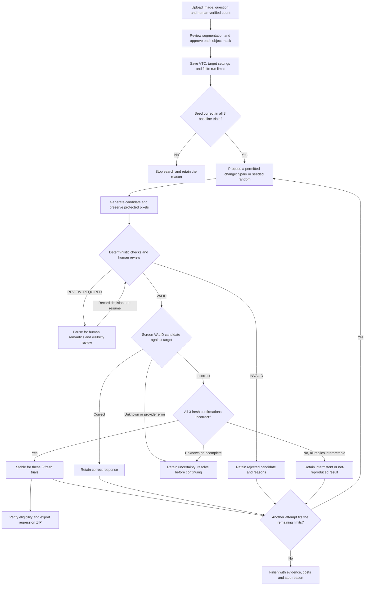
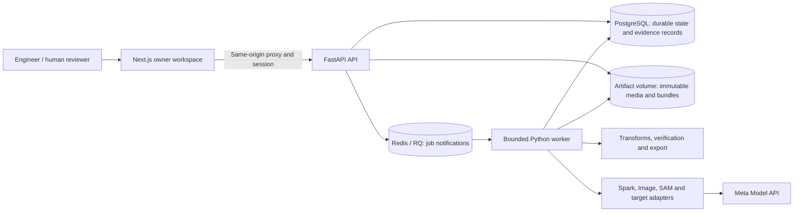

# CounterForge

Find the failure. Prove the weakness. Prevent the regression.

CounterForge is a reliability lab for vision-language models, developed for the
**Meta hackathon**. An engineer supplies an image, a counting question and a
human-verified answer. CounterForge searches for controlled image changes that
preserve that answer but cause the target model to answer incorrectly. When a
failure survives review and fresh confirmation, the system can package its
evidence as a portable regression test.

For example, a seed image contains five blue mugs. CounterForge can change the
lighting or surrounding background while preserving the approved mug pixels.
The answer must remain five. A changed image only becomes a useful test after
its count and visibility have been reviewed; an incorrect model response then
needs separate confirmation before it qualifies for export.

The MVP focuses on **single-image object counting with 1–16 protected instances**.
It serves AI engineers investigating model blind spots and QA engineers checking
whether validated failures persist across target configurations. The application
runs locally with an authenticated owner workspace, bounded server-side provider
calls and retained evidence. It does not automatically repair or retrain models.

## Contents

- [Capabilities](#capabilities)
- [Experiment flow](#experiment-flow)
- [System architecture](#system-architecture)
- [Current results and limits](#current-results-and-limits)
- [Development setup](#development-setup)
- [Model roles](#model-roles)
- [Run local services](#run-local-services)
- [Run a bounded experiment](#run-a-bounded-experiment)
- [Inspect and export a finding](#inspect-and-export-a-finding)
- [Verification and maintenance](#verification-and-maintenance)
- [Project structure](#project-structure)
- [Further documentation](#further-documentation)

## Capabilities

| Capability | What CounterForge provides |
| --- | --- |
| Reviewed ground truth | Image normalization, human count labels, editable instance masks and approval tied to exact asset revisions. |
| Visual Test Contracts (VTCs) | Versioned definitions of the protected objects, expected answer, allowed mutation families, invariants and run limits. |
| Controlled mutations | Deterministic brightness and clutter changes, plus Muse Image background generation with the approved foreground preserved. |
| Search strategies | Initial Spark planning, optional feedback-driven Spark planning and a seeded random baseline. |
| Independent validity checks | Provenance, geometry and pixel checks; SAM supporting evidence; mandatory human semantic and visibility decisions. |
| Bounded execution | Durable jobs, candidate/call/dollar/runtime caps, conservative cost reservations, pause/resume/cancel and explicit handling of uncertain charges. |
| Evidence inspection | Original/candidate/difference images, masks, validation history, model responses, target settings, costs and event timelines. |
| Reproduction and regression | Separate screening and fresh confirmation, reviewed reduction probes, verified regression ZIPs and bounded retests against another target configuration. |
| Evaluation and CI | A frozen matched-budget evaluation/audit harness and an offline CI consumer with labeled synthetic controls. The full real-model benchmark remains pending. |

## Experiment flow



All provider dispatches must fit the applicable authorization and budget;
confirmation calls are reserved before dispatch. Human-review pauses consume
wall-clock time. An unfinished confirmation is inconclusive, and uncertain
provider outcomes require reconciliation rather than a blind retry. The diagram
shows the main decision flow; export is a separate owner-requested job, and a
finding does not itself end an experiment's remaining search attempts.

A VTC fixes the expected answer. Neither the planner, target model nor SAM can
silently change it or approve a candidate. Deterministic checks establish
structural properties; a human still checks count, semantic integrity and
visibility. Required failures produce `INVALID`, and unresolved required checks
remain `REVIEW_REQUIRED`.

The regression ZIP contains the retained images, expected and observed answers,
model settings, mutation provenance, manifest, checksums and a Pytest runner. Its
assertion checks correctness: a model that reproduces the counting error fails
the test; a model that returns the correct count passes. Offline replay preserves
the recorded response and is labeled separately from a fresh live call.

## System architecture



The **web app** handles project setup, mask editing, review, experiment monitoring
and the regression library. **FastAPI** owns authentication, typed requests,
idempotency, persistence and authorization. The **worker** advances experiments
and executes bounded provider operations and CPU-only export jobs.

**PostgreSQL is the source of truth** for experiment state, job intent, reviews,
observations, usage and budgets. Redis provides queue notification; recovery uses
durable database records. Media and bundles live in a persistent,
content-addressed artifact volume and are checked against retained hashes.

Model credentials stay server-side. The default deployment binds ports to
loopback and requires an owner session for research controls. A separate,
explicitly published read-only snapshot can expose selected reviewed evidence;
preparing a draft does not publish it. See [architecture](docs/architecture.md)
and [security](docs/security.md) for the detailed boundaries.

## Current results and limits

The experiment, review, confirmation, export, refinement and retest workflows are
implemented. The evaluation harness and offline regression CI are also
implemented; synthetic controls verify pipeline behavior and do not establish a
real-model weakness.

The supervised **November 4, 2026 one-seed live pilot** completed with three
correct baseline replies and three human-reviewed brightness variants, all
counted correctly by Muse Spark 1.3. It consumed **6 target calls** and reported
**USD 0.028916 total provider usage**, including planner and SAM operations, with
no unresolved charges at completion. Run ID:
`44d5e899-184d-4d47-a644-38c4b67d38d4`. This is a small workflow demonstration;
it establishes no stable counting failure or advantage over random search.

The full 12-case matched-budget benchmark, independent audit and automatic
threshold calibration remain outstanding. The proposed 100-variant and audited
validity targets are goals, not measured results. No genuine stable failure is
currently claimed. Public product/video publication and final submission remain
pending, and `release_ready` remains **false**. Current gates are tracked in the
[release evidence index](docs/releases/evidence-index.json),
[benchmark preparation ledger](docs/benchmark/00-status.md) and
[limitations](docs/limitations.md).

## Development setup

Requires Python 3.12, uv 0.13.6 or compatible, Node.js 24 LTS and npm. Docker
Compose supplies PostgreSQL 16, Redis 7, the API, worker, web app and persistent
artifact storage.

```bash
uv sync --locked
npm ci --prefix apps/web
make check-contracts
make lint
make typecheck
make test
make build-web
```

`make test` runs unit and contract checks with outbound sockets disabled, even
when a live-test flag is inherited. After changing canonical contracts, run
`make generate-contracts`, review the generated diff and run `make check-contracts`.

### Fresh checkout (fixture-first)

```bash
git clone <repository-url> CounterForge && cd CounterForge
export UV_LINK_MODE=copy UV_CACHE_DIR=/tmp/counterforge-uv-cache
uv sync --locked            # exact Python deps from uv.lock; Python 3.12
npm ci --prefix apps/web    # exact web deps from apps/web/package-lock.json; Node 24
cp .env.example .env        # set POSTGRES_PASSWORD and a strong OWNER_AUTH_TOKEN only
make compose-check
make services-up            # Compose runs migrations before API/worker/web start
make test                   # offline unit+contract; no provider calls
```

No development database, `.env`, or private attachment is needed for
the offline checks. Migration order is owned by Compose on
`services-up`; for host development run `make migrate` explicitly
before `make dev-api`/worker (below).

**Private owner setup** is the default local stack above: owner token
stays server-side, ports bind to loopback, projects are scoped by
`OWNER_LABEL`.

**Optional live execution** is never part of fresh setup. It requires
`PROVIDER_MODE=LIVE`, `RUN_META_LIVE_TESTS=1`, a server-only
`MODEL_API_KEY`, an existing finite operator allowance, and explicit
per-run call/dollar/runtime limits (see *Explicit live smoke gate*).
Fixture mode (`PROVIDER_MODE=FIXTURE`,
`ALLOW_SYNTHETIC_FIXTURES=1`, `APP_ENV=development`) is synthetic and
labeled; it is not live evidence.

## Model roles

| Role | Model | Notes |
| --- | --- | --- |
| Planner | Muse Spark 1.3 (`muse-spark-1.3`) | Typed experiment plans; labeled deterministic fallback on invalid/unavailable output |
| Generator | Muse Image 1.0 (`muse-image-1.0`) | Bounded scene/background generation and edits |
| Perception | SAM 3.1 (`sam-3.1`) | Segmentation proposals; human review is authoritative, SAM agreement cannot approve |
| Target under test | Muse Spark 1.3 (curated `META_SPARK`) | **Shares the Spark model family with the planner**; planner/target independence is not claimed |
| Validity review | Deterministic verifier + human reviewer | Independent of the target; no model self-approval |

Configured revision labels are provider-managed: they do **not** pin
binary weights, and a later provider revision may behave differently.
No formal safety proof is claimed. Details:
[provider record](docs/plans/phase-03-provider-record.md).

Release status, acceptance evidence, and attribution:
[release evidence index](docs/releases/evidence-index.json),
[submission matrix](docs/submission.md), [ATTRIBUTION.md](ATTRIBUTION.md),
[API reference](docs/api.md), and [limitations](docs/limitations.md).
Original code is under the [MIT License](LICENSE) (owner-confirmed);
third-party work keeps its own licenses (see ATTRIBUTION).
Run `make release-check` for offline structural validation; a passing structural
check does not by itself establish release readiness.

## Run local services

Copy `.env.example` to an ignored `.env` and configure `POSTGRES_PASSWORD` and a
strong `OWNER_AUTH_TOKEN`, or export the values explicitly. Compose reads its
environment file; Python services read process environment without loading dotenv
files. The web service receives the owner token on its server only.

```bash
make compose-check    # validates without printing resolved configuration
make services-up      # builds, migrates and starts the local stack
# Open http://localhost:3000 and sign in with the configured owner access token.
make services-down    # retains persistent volumes
```

For operations (readiness, backup/restore, Redis-loss recovery, retention,
latency, and the disposable rehearsal) see the
[operations runbook](docs/operations/runbook.md); all `make ops-*` targets
make no direct provider calls. Restore requires `CONFIRM_DISPOSABLE=1` and empty
disposable destinations; retention is dry-run by default. Keep workers stopped
or providers disabled through restore/recovery reconciliation, since recovered
authorized work can resume billing under LIVE workers.

All published ports bind to loopback. Override `POSTGRES_PORT`, `REDIS_PORT`,
`API_PORT` or `WEB_PORT` as needed. Set `WEB_ORIGIN` to the exact browser origin,
default `http://localhost:3000`. `OWNER_LABEL` scopes projects; changing it changes
which projects this owner can access.

For host development, export the PG components or a fully expanded
`postgresql+psycopg` `DATABASE_URL`, plus `REDIS_URL`, `ARTIFACT_ROOT`,
`OWNER_AUTH_TOKEN`, `OWNER_LABEL`, `WEB_ORIGIN` and `API_INTERNAL_URL`. Then run
`make migrate`, `make dev-api`, `python -m services.worker.app.main` and
`make dev-web` in separate terminals. Use `ENQUEUE_JOBS=1` in both API and worker environments for job notification.
`API_INTERNAL_URL` defaults to `http://127.0.0.1:8000` for the Next server.
Nested variable interpolation is rejected; component passwords remain literal data.

The API docs are at `http://127.0.0.1:8000/docs`. Business routes require
`Authorization: Bearer <OWNER_AUTH_TOKEN>`. The browser uses an opaque, eight-hour
HttpOnly/SameSite=Strict session and an allowlisted same-origin proxy. Mutations
require the configured Origin; upstream owner/model keys never become browser
DTOs, URLs or local-storage values. Anonymous image reads require the current
approved, hash-bound demo snapshot. `/demo` is a read-only recorded gallery;
preparing a private draft grants no public access. Publication remains a Phase 10
action with explicit intent and redistribution acknowledgement.

## Prepare and review a seed

Create a project, upload a rights-cleared image, enter the counting question and
human count, and name its label reviewer. JPEG, PNG and single-frame WebP inputs
are limited to 10 MiB and 16 megapixels. A bounded subprocess applies EXIF
orientation, composites alpha on white and creates a metadata-free RGB PNG.
Original bytes/SHA, normalized SHA and pixel SHA are retained separately. Upload
filenames never determine storage paths.

Configure a curated `META_SPARK` or synthetic `LOCAL_FIXTURE` target. New targets
saved through the workspace pin temperature to 0, `top_p` to null and the output
limit to 1,024 tokens. Existing targets retain their saved settings. A target
check is one handshake; it is not the full seed baseline from phase 05. Request
segmentation with explicit call, dollar and runtime limits, then inspect each
instance over the source image. Paint, erase or use source-coordinate rectangles
to correct masks; add missing instances or retire extras. Corrections create new
immutable assets, retain old approval evidence and clear approval on the current
revision. Mask PNGs must be binary, nonempty and exactly match the source geometry.

Approve each exact current mask and acknowledge any detection/count discrepancy.
The human count never changes automatically. A new VTC requires one distinct
approved mask per expected object. Locked historical contracts and started runs
retain their precise asset revisions; a new run rechecks current review and source
integrity. Lists use signed scoped cursors with at most 100 items.

## Generate and review a candidate

Use the authenticated API to create an experiment intent with an approved VTC
and target, then `POST /api/v1/experiments/{id}/mutations` with an
`Idempotency-Key`, typed `plan` and `rng_seed`. Supported families are
`background_replacement`, `background_clutter` and `brightness_shift`.
The Phase 05 scheduler advances started experiments when provider dispatch and queue notification are enabled.

For a generative background, first request
`POST /api/v1/contracts/{id}/backgrounds` with the generative plan and explicit
finite job limits. After that job succeeds, supply its `background_job_id` with
the same plan when creating the candidate. Original approved foreground pixels
are copied exactly onto the normalized background. Candidate segmentation via
`POST /api/v1/mutations/{id}/segment` is optional supporting evidence and uses the
same bounded accounting. Manually requested pre-experiment preparation has its own
explicit allowance; orchestrated preparation is charged to the experiment budget.

Open `/mutations/{id}` in the owner workspace to inspect original, candidate,
background, protected union, pixel diff, source masks, recipe and revision history.
New candidates require human semantic and visibility decisions. A required FAIL
means INVALID; an unresolved required check means REVIEW_REQUIRED. SAM agreement
cannot approve a candidate. Confirmed visibility destruction is INVALID;
ambiguous visibility stays REVIEW_REQUIRED.

Review binds the current report and exact evidence hashes. A stale decision is
rejected; reload and review again. Resolving a prior human rejection requires an
explicit ground-truth audit with notes and named failed checks. Structural failures
cannot be overridden. Identical retained candidate images within one experiment
share the original recipe and review history, including rejections.

Recipes record exact parameters and runtime versions. Strength is specific to
each family: brightness `0.5` is the identity, replacement `0` is the identity,
and clutter `0` already draws one rectangle. It is not a universal severity scale.
See the [Phase 04 handoff](docs/plans/phase-04-handoff.md) for integration rules.

## Run a bounded experiment

In project setup, choose a reviewed contract and target, tighten the candidate,
target-call, dollar and wall-clock limits, then start. The cockpit displays saved
state, baseline progress, review reasons, cap exposure and findings. A same-page
retry of an unchanged start request reuses its idempotency key. After navigation
following an uncertain reply, inspect Previous runs before creating another run.

ADAPTIVE defaults to `ONE_SHOT`, retaining the original Spark plan
(`spark-initial-v1`) and labeled fallback. Opt into `FEEDBACK_V1` to supply actual
sanitized outcomes and remaining limits to subsequent Spark batches. The cockpit
retains each batch's input history, proposed/selected/rejected rankings, costs and
policy revisions. At least 20% of bounded attempt slots belong to seeded random
exploration; unused exploration slots are never reassigned to exploitation.

RANDOM_BASELINE uses recorded seeded proposals without planner calls. An optional
`random_seed` makes proposals reproducible; new runs retain its actual value and
`random-initial-v2` revision. Strategies share permitted families and the full
`[0,1]` strength range, subject to each contract. See the
[frozen feedback policy](docs/plans/phase-07-policy.json) for engineering defaults;
no improvement over random is claimed. Generated candidates pause for
human semantics/visibility review. Review the retained comparison evidence, record
a decision, return to the experiment and resume. Paused time counts toward runtime.

Pause and cancel drain in-flight calls, which may remain charged. Unknown charges
or lost provider outcomes require operator resolution before resume. Reservations
cover all fresh confirmations before their first dispatch. Actual usage, estimates
and unresolved charges are components of committed exposure, not additive totals.
Recovery reuses retained target receipts and never blindly repeats an ambiguous
paid request. SSE replay remains private and uses no credentials in URLs.

## Inspect and export a finding

Open a finding from the experiment cockpit to inspect its exact original,
candidate, difference and protected mask, current validity and review history,
baseline/screening/fresh observations, target settings and API usage. A regression
export requires sealed current VALID evidence, a correct three-call seed baseline,
a separate incorrect screen and three canonical fresh incorrect confirmations.
Human showcase approval is a separate action.

Request the export once, then follow its queued/running status. The worker builds
and verifies the ZIP before marking it READY; CPU-only exports also work with
providers disabled. The owner-only Regression library retains the ZIP/manifest
SHA-256 and runner instructions. Library rows show Registered; choose Verify bundle
for download to recheck current evidence before receiving its download link. Later
invalidation revokes download eligibility,
including direct bundle/manifest asset access, while retaining historical bytes.
Fixture bundles are prominently labeled `LOCAL_FIXTURE`.

After downloading, compare the ZIP SHA-256 with the library value, extract into a
new directory, and verify its members before trusting the runner. Keep the Python
environment outside that directory:

```bash
sha256sum -c sha256sums.txt
python3.12 -m venv /tmp/counterforge-regression-env
/tmp/counterforge-regression-env/bin/python -m pip install -r requirements.txt
COUNTERFORGE_RUN_MODE=replay /tmp/counterforge-regression-env/bin/python -m pytest -q tests
```

Recorded replay is offline and preserves the historical incorrect response, so
its correctness assertion fails with expected/actual values. A healthy target
passes; transport, refusal, parser and integrity problems are execution errors.
A real-provider bundle supports explicit `--live` execution with `MODEL_API_KEY`
in the environment: one bounded provider call, no automatic retries. Provider
behavior may change. `make verify-export` checks the healthy/broken/replay/tamper
pair offline and succeeds only when each fails or passes for the intended reason.

## Refine and retest retained findings

Open a stable finding's refinement panel to test up to eight simpler variants.
All original experiment caps, including elapsed wall-clock time, still apply.
Brightness moves toward identity 0.5; deterministic clutter removes recorded
layers. Unsupported backgrounds and unsuccessful probes retain the original
finding. Each new child pauses for independent review; explicitly resume after
review. A reduced stable failure needs its own screen and three fresh incorrect
confirmations. Passing neighbors remain boundary evidence. Results describe the
simplest tested stable variant, not a global minimum.

After verifying an export, its retest panel can start a new bounded job against an
enabled curated target configuration. The exact bundle image, prompt and human
answer stay fixed; target-B settings and observations are retained separately.
Each new job has explicit call, dollar and runtime limits under the deployment
allowance. Three correct replies mean fixed, three wrong persistent, and three
interpretable mixed replies intermittent. Any unknown, error, partial result or
budget stop is inconclusive. Historical target-A evidence and ZIP bytes remain
intact. Revision labels do not guarantee a separately pinned provider model.

## Declare a small strategy comparison

Create one ADAPTIVE and one RANDOM_BASELINE intent against the same approved
seed/contract/target with identical limits and an explicit `random_seed`. Keep
queue dispatch disabled until the declaration is saved. The operator command
checks matched snapshots and refuses prior provider reservations:

```bash
python -m scripts.compare_strategies declare --adaptive ADAPTIVE_UUID --random RANDOM_UUID \
  --code-revision SOURCE_REVISION --output comparison-declaration.json
# After the bounded runs and independent candidate review:
python -m scripts.compare_strategies report --manifest comparison-declaration.json \
  --output comparison-report.json
```

These commands read the owner's database and never dispatch a provider. Reports
retain zero discoveries, unfinished/stopped arms, invalid/review-required outputs,
baseline/screening/confirmation denominators and all category costs, including
estimates and unknown charges. A single development seed supports a descriptive
check; it does not establish that one strategy outperforms another.

## Provider modes and offline fixtures

`PROVIDER_MODE=DISABLED` is the default. Manual seed and mask review work without
provider dispatch. Live mode additionally requires `RUN_META_LIVE_TESTS=1`, a
server-only `MODEL_API_KEY`, finite job limits and an unexpired operator allowance.
SDK construction and curated model names do not prove entitlement.

For a synthetic development session, set `APP_ENV=development`,
`PROVIDER_MODE=FIXTURE` and `ALLOW_SYNTHETIC_FIXTURES=1`, then recreate the services.
The workspace can load the original CC0 development image with five separate blue
rectangles. Only its known SHA is supported by wire fixtures. SAM intentionally
returns four proposals so the missing-instance workflow is exercised. All output
is labeled synthetic; the official parser and SDK still execute locally.

No deployment allowance exists by default. Configure a finite zero-dollar fixture
allowance explicitly:

```bash
docker compose exec api python -m scripts.configure_job_allowance \
  --max-usd 0 --max-calls 100 --expires-in-minutes 60 --actor local-owner
docker compose exec api python -m scripts.configure_job_allowance --show
```

Each provider attempt reserves and commits, claims and commits before wire I/O,
then reconciles in a fresh transaction. A PostgreSQL session lease limits global
provider concurrency to one without holding a SQL transaction across network I/O.
Actual usage, conservative estimates and unresolved charges remain separate.
Missing usage is not priced at zero. Ambiguous post-send failures retain their
upper-bound charge and are never automatically retried. Only proven connection
failures and explicitly authorized unbilled rejections can receive bounded retries.

Allowance updates retain consumed totals. Lower ACTUAL costs do not refund the
shared conservative upper bound; higher costs increase it. Undispatched voids and
trusted UNBILLED proofs release reserved dollars once. Pre-send proofs release
call capacity too; a sent unbilled 429 still consumes a call.

PostgreSQL is the source of job intent. Redis notification occurs after commit;
a Redis failure leaves a queued record. Startup recovery and `make recover-jobs`
rescan queued/expired setup jobs. Duplicate deliveries do nothing. Expired
undispatched work can be requeued; dispatched ambiguous work and lost settled
output require review and a deliberate new job. RQ carries a UUID-only JSON
payload and has no automatic provider retry policy.

## Explicit live smoke gate

Read [the provider record](docs/plans/phase-03-provider-record.md) before live
configuration. The fixed API origin is `https://api.meta.ai/v1`; current standard
SKUs are Spark 1.3, Image 1.0 and SAM 3.1. Pricing comes from root `pricing.toml`.
No generated-image CDN host has been verified, so URL downloads fail closed by
default and base64 output is requested.

`make smoke-meta` requires `PROVIDER_MODE=LIVE`, `RUN_META_LIVE_TESTS=1`, a model
key, an existing operator allowance, explicit finite `SMOKE_META_MAX_USD`,
`SMOKE_META_MAX_CALLS` (at least four), `SMOKE_META_MAX_RUNTIME_SECONDS`, and owned
`SMOKE_META_SEED_ID`, `SMOKE_META_VTC_ID`, `SMOKE_META_TARGET_ID` references with
current reviewed evidence. It exercises planner, SAM, image and target sequentially
through the same accounting. It records sanitized evidence IDs and usage. No live
smoke was run during phase 03 implementation. The Phase 05 handoff records the
later authorized bounded live capability test and its exact remaining gates.

## Verification and maintenance

Provision disposable loopback services and opt in explicitly:

```bash
export COUNTERFORGE_TEST_DATABASE_URL=postgresql+psycopg://counterforge_test@127.0.0.1:55432/counterforge_test
make test-db
export COUNTERFORGE_TEST_REDIS_URL=redis://127.0.0.1:56379/15
uv run --locked python -m playwright install chromium
make build-web
make test-e2e
```

Database tests create and drop only their random schemas, retaining test `pgcrypto`
in `public`. Browser verification creates its own schema, queue, artifact root,
service processes and zero-dollar fixture allowance, then cleans up those owned
resources. It checks five-object seed setup, candidate verdicts, explicit audits,
stale evidence, missing images, revision history, session renewal, privacy, CSRF
authenticated finding exports, revocation, portable runners and mobile overflow. It never
falls back to application `DATABASE_URL` or flushes shared Redis data. CI runs
unit, contract, database and browser suites with live Meta calls disabled.

Orphan maintenance defaults to a dry run and a minimum 24-hour age. Referenced
assets are retained; registration and maintenance share a transaction lock:

```bash
docker compose exec api python -m scripts.maintain_artifacts --dry-run
# After inspecting the report:
docker compose exec api python -m scripts.maintain_artifacts --delete
```

Migration `0001` executes the supplied SQL byte for byte. `0002` adds workflow and
budget support; `0003` adds explicit billing provenance, job fencing and append-only
mask history; `0004` adds immutable candidate evidence, request aliases and ordered
append-only validation history; `0005` adds frozen experiment snapshots, canonical
confirmation and durable dispatch. Phase 06 uses that schema without changing the
supplied SQL. Downgrades refuse to discard evidence. Asset reads verify paths,
size and SHA; content-addressed blobs are fsynced and atomically installed before
transactional registration.

Migration `0006` adds feedback, refinement and retest support; `0007` adds retained
public demo snapshots and their explicit asset whitelist.

## Project structure

```text
apps/web/          Owner setup, evidence, regression library and API types
services/api/      Authenticated API, database, artifacts and accounting
services/worker/   Durable experiments, CPU export jobs and recovery
packages/          Contracts, adapters, verification and portable bundles
evaluations/       Frozen protocols, matched-budget runs, audit and reports
fixtures/phase03/  Original CC0 development seed and manifest
scripts/           Contract generation, smoke, comparison, release and maintenance
tests/             Offline, PostgreSQL and real-process browser checks
tests/fixtures/phase04/  Labeled synthetic candidate evidence specimens
.github/workflows/ Quality checks and offline regression CI
docs/plans/        Ordered phases and verification handoffs
docs/guides/       Human review, live testing and submission preparation
docs/benchmark/    Dataset/protocol drafts and genuine benchmark gates
docs/releases/     Release evidence and readiness receipts
```

## Further documentation

| Topic | Reference |
| --- | --- |
| Product scope and requirements | [PRD](docs/CounterForge_PRD_v1.0.md) |
| System contracts, state machines and original design | [Technical specification](docs/CounterForge_Technical_Specification_v1.0.md) |
| Complete documentation and implementation history | [Documentation index](docs/README.md) and [roadmap](docs/plans/README.md) |
| Feedback search, refinement and retests | [Phase 07 handoff](docs/plans/phase-07-handoff.md) and [frozen policy](docs/plans/phase-07-policy.json) |
| Matched-budget evaluation and independent audit | [Evaluation guide](docs/evaluation.md) and [Phase 08 handoff](docs/plans/phase-08-handoff.md) |
| Operational architecture and recovery | [Architecture](docs/architecture.md), [operations runbook](docs/operations/runbook.md) and [Phase 09 handoff](docs/plans/phase-09-handoff.md) |
| Offline regression CI, controls and trust boundaries | [Phase 12 handoff](docs/plans/phase-12-handoff.md) |
| Release acceptance, attribution and publication gates | [Submission matrix](docs/submission.md), [Phase 10 handoff](docs/plans/phase-10-handoff.md) and [attribution](ATTRIBUTION.md) |
| Supervised testing, recording and submission preparation | [Live final-testing guide](docs/guides/live-final-testing.md) |

The PRD, technical specification and supplied SQL are the source design
documents. Implementation handoffs and evidence receipts record what has
actually been built and verified, including deviations and remaining gates.
